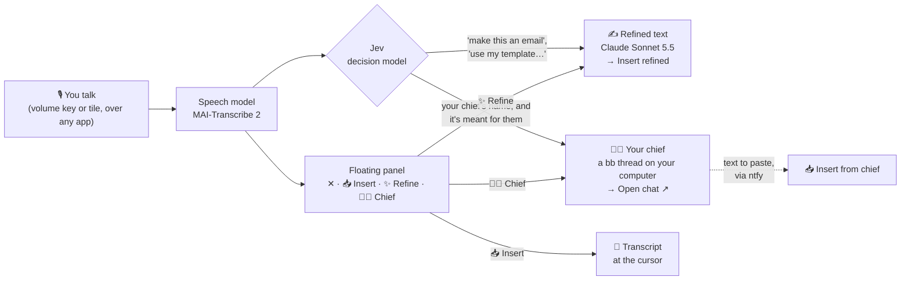
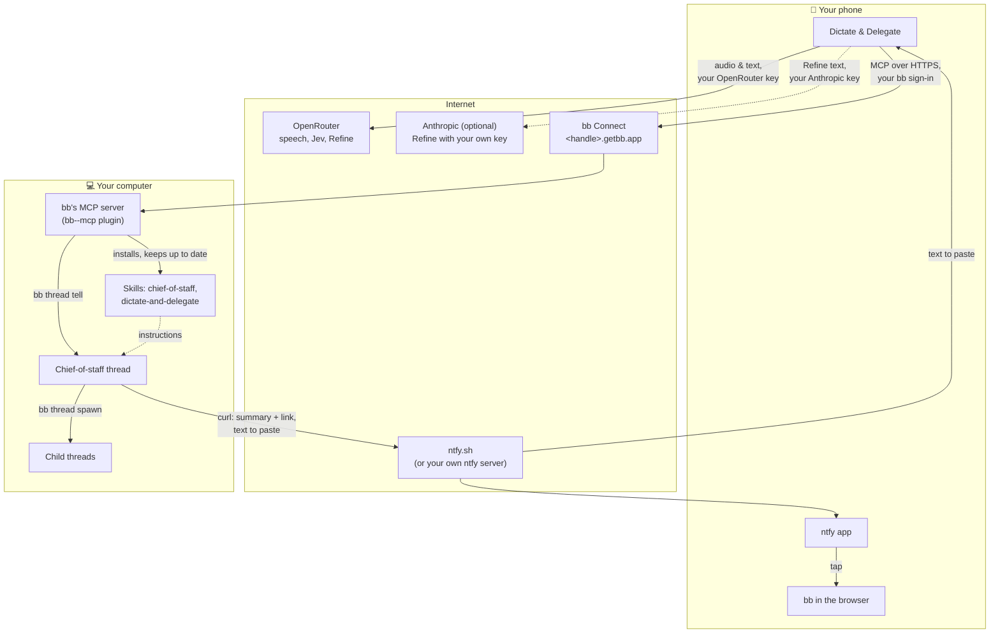
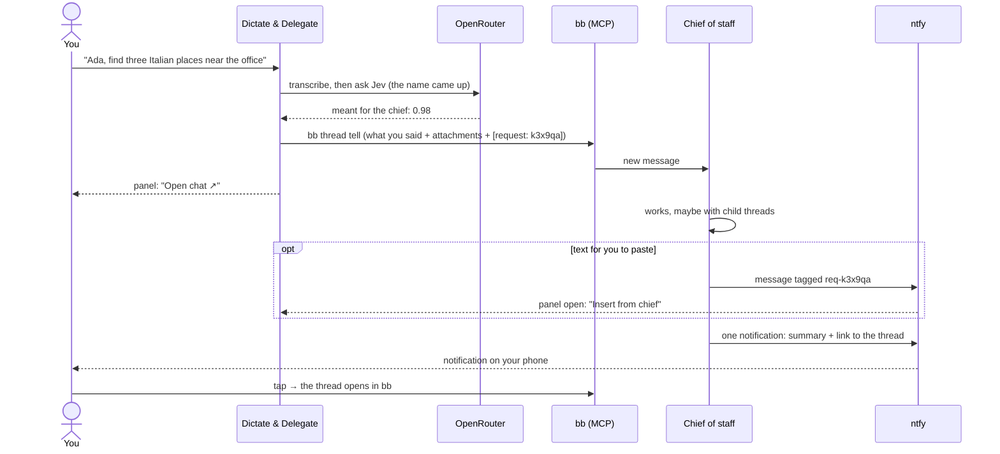
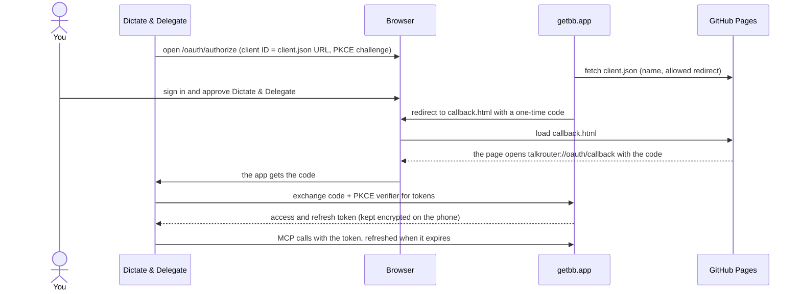

# How Dictate & Delegate works

The short version is in the [README](../README.md). This page has the details: every feature, the diagrams, and how sign-in to bb works.

## Features
| | |
|---|---|
| **Start anywhere** | Hold volume down or up (Accessibility), tap the Quick Settings tile, or use the button in the app. A short press still changes the volume. |
| **Floating panel** | Appears over any app, never takes focus, and can be dragged anywhere. While you record: ■ stop, ✨ Refine, 🧑‍💼 Chief, ✕ cancel, 📎 attach. Tap ✨ or 🧑‍💼 while still talking, and it runs as soon as the transcript is ready. |
| **📥 Insert** | Puts the text at the cursor of the app you're in. Dictate & Delegate never puts anything on your clipboard by itself; only if Insert can't reach a field does it copy instead, and the panel tells you. |
| **✨ Refine** | One call to Claude Sonnet 5.5 (or the model you pick) works out what the text is for (message, email, note, reply), follows what you asked, fills in a template you named, and keeps your language and facts. **Insert refined** then replaces the raw transcript in place, if you haven't changed it. Runs through OpenRouter, or through Anthropic directly with your own Anthropic key. |
| **Templates** | Texts you write again and again (an application, a standard reply). Say "use my apartment application for…" and Refine fills it in. |
| **📎 Attach** | Talking about something, like a listing you're replying to? While you record, add what you copied, an image or a PDF. Refine reads it, and the chief gets it too. |
| **🧑‍💼 Chief of staff** | Sends what you said, plus anything you attached with 📎 (copied text, images, PDFs), to a bb thread on your computer that acts for you: small things itself, bigger work in parallel child threads. It notifies you through [ntfy](https://ntfy.sh) when it's done or needs you. |
| **Say its name** | Give your chief a name, say "Ada, …" or "this is for Ada", and the dictation goes there by itself. "Say hi to Ada" stays with you: a fast decision model (Jev) tells the two apart. |
| **Text back** | When the chief writes something for you to paste, **Insert from chief** appears on the panel (or **Copy** on the notification). |
| **Costs in view** | Every note shows what it cost, usually a fraction of a cent. Activity shows which model did what and how long it took. |
| **Notes** | Every dictation is kept on the phone, in the app's private storage: what you said and the refined version. Redo a note with a more accurate speech model. |

Eight languages in the app: English, German, French, Spanish, Italian, Portuguese, Dutch, Polish. The speech model understands many more, and you can switch languages mid-sentence.

## One start, three ways on

After the transcript, Jev (about 0.3 s and $0.00003) answers a few questions: did you ask for a text or name a template? Then Refine starts by itself. Did your chief's name come up, and is the dictation meant for them? Then it goes to the chief by itself, as you said it. If Jev isn't sure, 🧑‍💼 is only highlighted; if Jev fails, nothing happens by itself and the buttons still work.

## Who talks to whom

There is no Dictate & Delegate server. The phone talks directly to the services you set up, with your own accounts:

- **OpenRouter** runs speech, Jev and Refine. You pay OpenRouter directly for what you use; a one-minute note usually costs well under a cent. With your own **Anthropic** key, Refine goes to Anthropic directly on your Anthropic credits, with OpenRouter as the fallback.
- **bb** is an agentic IDE that runs coding agents (Claude Code, Codex, …) on your own computer. Dictate & Delegate uses bb's built-in MCP server to create the chief-of-staff thread and send it your dictations. The chief's instructions are two bb skills that Dictate & Delegate installs and keeps up to date by itself: **chief-of-staff** (how to work for you: small things itself, bigger work split into child threads with context, intent and what done looks like) and **dictate-and-delegate** (how to read dictations, notify you and send text back).
- **ntfy** carries the chief's notification (one per request, with a summary and a link to the thread) and text meant for you to paste. Your topic is a long random name only you know. Dictate & Delegate itself sends no notifications.

## Handing off a task

If bb can't be reached, the app tries again a few times within seconds (bb Connect's tunnel to your computer drops now and then and is back quickly). If that isn't enough, the note keeps what you said and the request ID, says why, and sends it again by itself, further apart each time (15 s up to every 15 min, for two days), also after a restart or once the network is back. A try after one whose answer got lost checks the thread first, so the chief never gets a note twice. **Retry now** and **Send report** are on the note; once bb takes messages again, the chief gets an `[app failure report]` with what failed, when, and the network log around it.

## Signing in to bb

Dictate & Delegate reaches your bb through bb Connect (`https://<handle>.getbb.app/mcp`) with OAuth 2.1 and PKCE: no password or secret goes into the app. bb has no app registration; an app's ID is the address of a small public JSON file describing it. Dictate & Delegate's lives on this repo's GitHub Pages ([client.json](https://philipp258.github.io/dictate-and-delegate/oauth/client.json)).

The redirect goes through a page on GitHub Pages because bb only accepts an `https` address next to the client file. The code is useless without the verifier, which never leaves the phone. Instead of bb Connect you can enter any address of bb's MCP server yourself, for example one on your tailnet, with an optional token.

