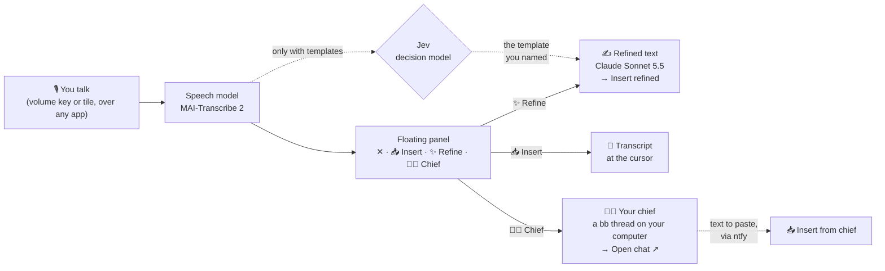
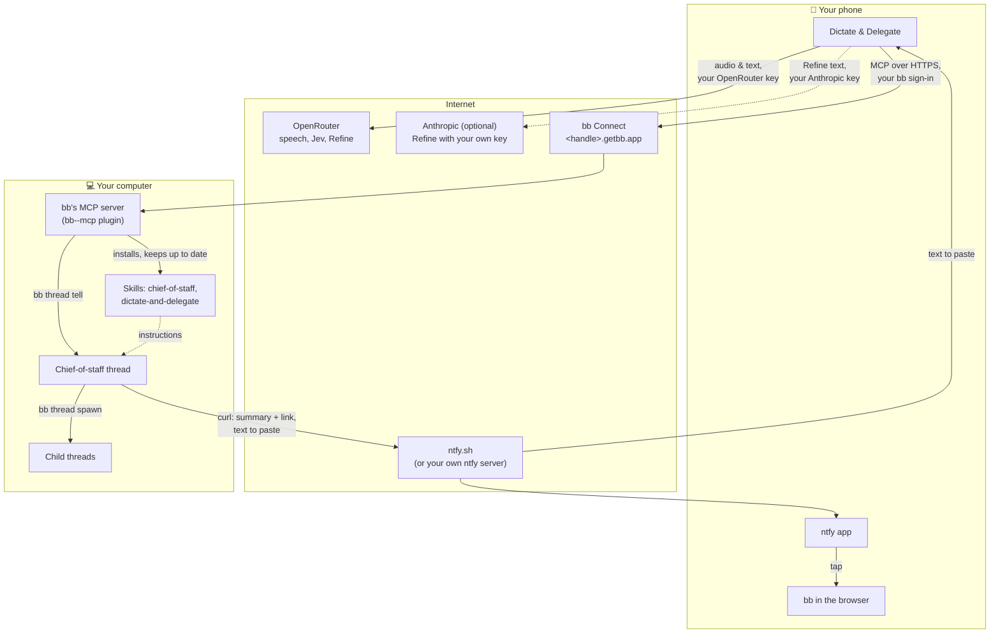
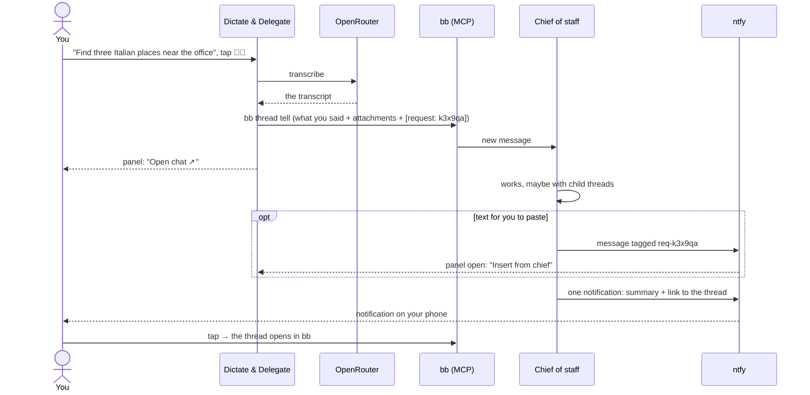
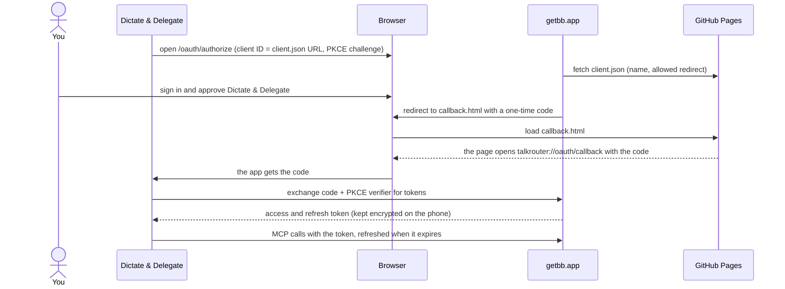

# How Dictate & Delegate works

The short version is in the [README](../README.md). This page has the details: every feature, the diagrams, and how sign-in to bb works.

## Features
| | |
|---|---|
| **Start anywhere** | Hold volume down or up (Accessibility), tap the Quick Settings tile, or use the button in the app. A short press still changes the volume. With a second assistant, the other volume key starts a dictation for it. |
| **Floating panel** | Appears over any app, never takes focus, and can be dragged anywhere. While you record: ■ stop, ✨ Refine, 🧑‍💼 Chief, ✕ cancel, 📎 attach. Tap ✨ or 🧑‍💼 while still talking, and it runs as soon as the transcript is ready. Nothing runs or goes anywhere unless you tap it. |
| **📥 Insert** | Pastes the text at the cursor of the app you're in, through the clipboard; what you had copied is put back when Android allows it, otherwise the panel says the text is on the clipboard too. If Insert can't reach a field it copies instead, and the panel tells you. |
| **✨ Refine** | One call to Claude Sonnet 5.5 (or the model you pick) works out what the text is for (message, email, note, reply), follows what you asked, fills in a template you named, and keeps your language and facts. **Insert refined** then replaces the raw transcript in place, if you haven't changed it. Runs through OpenRouter, or through Anthropic directly with your own Anthropic key. |
| **Templates** | Texts you write again and again (an application, a standard reply). Say "use my apartment application for…", tap ✨ Refine, and it fills it in. |
| **📎 Attach** | Talking about something, like a listing you're replying to? While you record, add what you copied, an image or a PDF. Refine reads it, and the chief gets it too. |
| **🧑‍💼 Chief of staff** | Sends what you said, plus anything you attached with 📎 (copied text, images, PDFs), to a bb thread on your computer that acts for you: small things itself, bigger work in parallel child threads. It notifies you through [ntfy](https://ntfy.sh) when it's done or needs you. |
| **Two assistants** | A second bb with its own sign-in, chief, ntfy topic and skills, say "Personal" and "Work". The panel then has one round button for each, its initial in its colour (tap: send to it, hold while recording: call it), so it stays one row; holding the other volume key starts a dictation for the second (it only puts its buttons first). Calls, notes and failure reports stay with their assistant. |
| **Text back** | When the chief writes something for you to paste, **Insert from chief** appears on the panel (or **Copy** on the notification). |
| **Costs in view** | Every note shows what it cost, usually a fraction of a cent. Activity shows which model did what and how long it took. |
| **Notes** | Every dictation is kept on the phone, in the app's private storage: what you said and the refined version. Redo a note with a more accurate speech model. |

Eight languages in the app: English, German, French, Spanish, Italian, Portuguese, Dutch, Polish. The speech model understands many more, and you can switch languages mid-sentence.

## One start, three ways on

You choose where the transcript goes: nothing is refined or sent because of what you said (saying your chief's name sent a dictation there by itself until 3.7.0). If you have templates, Jev (about 0.3 s, a tiny fraction of a cent) answers one question after the transcript: which template does it name? A Refine you tap then uses it; if Jev fails, Refine runs without one. With two assistants, the panel has a button for each (its initial), and the dictation goes to the one you tap.

## Who talks to whom

There is no Dictate & Delegate server. The phone talks directly to the services you set up, with your own accounts:

- **OpenRouter** runs speech, Jev and Refine. You pay OpenRouter directly for what you use; a one-minute note usually costs well under a cent. With your own **Anthropic** key, Refine goes to Anthropic directly on your Anthropic credits, with OpenRouter as the fallback.
- **bb** is an agentic IDE that runs coding agents (Claude Code, Codex, …) on your own computer. Dictate & Delegate uses bb's built-in MCP server to create the chief-of-staff thread and send it your dictations. The chief's instructions are two bb skills that Dictate & Delegate installs and keeps up to date by itself: **chief-of-staff** (how to work for you: small things itself, bigger work split into child threads with context, intent and what done looks like) and **dictate-and-delegate** (how to read dictations, notify you and send text back).
- **ntfy** carries the chief's notification (one per request, with a summary and a link to the thread) and text meant for you to paste. Your topic is a long random name only you know. Dictate & Delegate itself sends no notifications.
- **A second assistant** is a second copy of the bb part: its own bb (another computer, or the same with another handle), sign-in, chief-of-staff thread, the same skills filled with its own topic and links, and its own ntfy topic. A hands-free call reads only the topic of the assistant it's with, so the other's replies are never read out in it.

## Handing off a task

Every note keeps its own journey, saved on the note, never only in memory: what it's for (just a dictation, or a request to your chief of staff, saved the moment you tap the assistant's button, also while recording), and two steps, writing it down and sending it, each with its state, every try, and the real error. Closing the panel, a retry, the app being stopped or a restart can't lose any of it. The note page says in one line where it is ("For Personal: not written down: … The audio is kept.", "Sent to Personal at 13:06 · request 7z8qzk"), **Details** under it shows every step and try with what the server answered, and the network log's lines for that note, to copy. Home lists what needs you under **Needs you**, one line each, and a phone notification says so too until it's resolved.

If the speech model can't be reached or the connection breaks off while the recording is going up (mobile data does this), the app tries again by itself for about a minute and a half, only while that can't cost twice: once OpenRouter could have the whole recording, a break isn't retried, since the model may already be working. If the model answers busy or rate-limited (HTTP 429) or with a server error (5xx), it's tried again twice, then with a second model from another provider on the same OpenRouter key (GPT Transcribe by default; Speech model → When it's busy), then both once more, over about a minute; the note says which model wrote it down. A recording that still isn't written down stays in your notes with its audio and **Retry** / **Discard**, with the error as the model's host gave it. Retry acts on that one recording only and never takes over the panel; once it's written down it goes on to the chief it was meant for. None of this holds you up: each recording is written down on its own, so you can record the next one at once, and ✕ on the panel stops trying (nothing then goes on by itself).

If bb can't be reached, the app tries again a few times within seconds (bb Connect's tunnel to your computer drops now and then and is back quickly). If that isn't enough, the note keeps what you said and the request ID, says why, and sends it again by itself, further apart each time, also after a restart or once the network is back, but only while it's fresh: within 15 minutes of the recording ending, your tap on the assistant's button, or your Send. After that it never goes by itself; it waits, with a notification, until you read it and tap **Send** or **Don't send**. A recording cut off without Stop, or one you stopped with ✕, also waits for you. A try after one whose answer got lost checks the thread first, so the chief never gets a note twice. **Retry now** and **Send report** are on the note; once bb takes messages again, the chief gets an `[app failure report]` with what failed, when, and the network log around it. With two assistants, each note is tried again with the assistant it was meant for, also days later, one bb being down doesn't hold up the other's notes, and each failure is reported to its own assistant's chief; one that belongs to neither (a recording that wasn't written down) goes to the first assistant that takes messages.

## Signing in to bb

Dictate & Delegate reaches your bb through bb Connect (`https://<handle>.getbb.app/mcp`) with OAuth 2.1 and PKCE: no password or secret goes into the app. bb has no app registration; an app's ID is the address of a small public JSON file describing it. Dictate & Delegate's lives on this repo's GitHub Pages ([client.json](https://philipp258.github.io/dictate-and-delegate/oauth/client.json)).

The redirect goes through a page on GitHub Pages because bb only accepts an `https` address next to the client file. The code is useless without the verifier, which never leaves the phone. With two assistants, each signs in on its own and keeps its own tokens; the sign-in waiting for the browser remembers which assistant it's for. Instead of bb Connect you can enter any address of bb's MCP server yourself, for example one on your tailnet, with an optional token.

